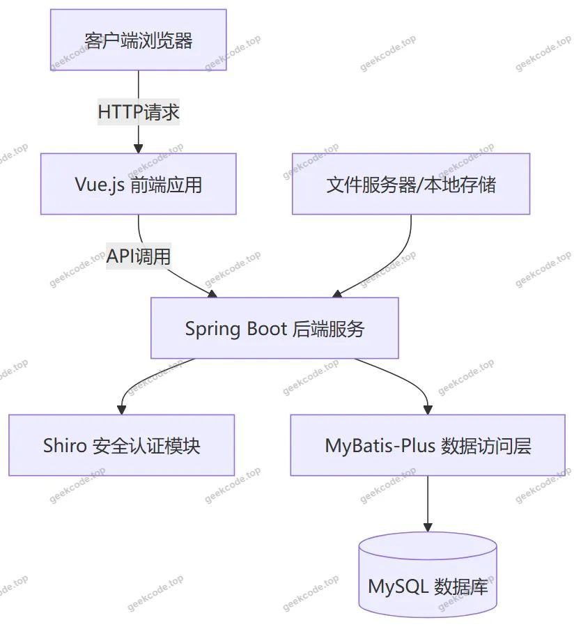
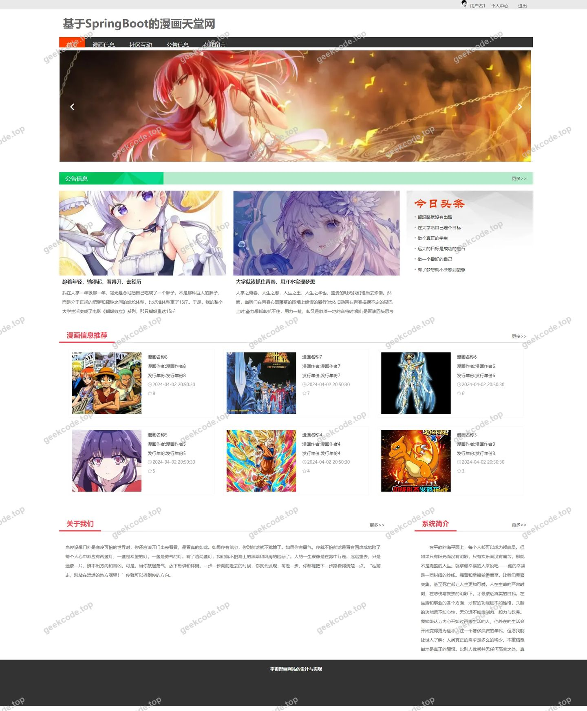
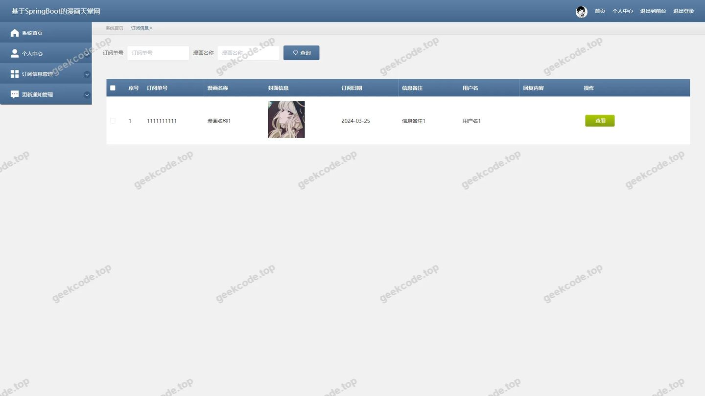
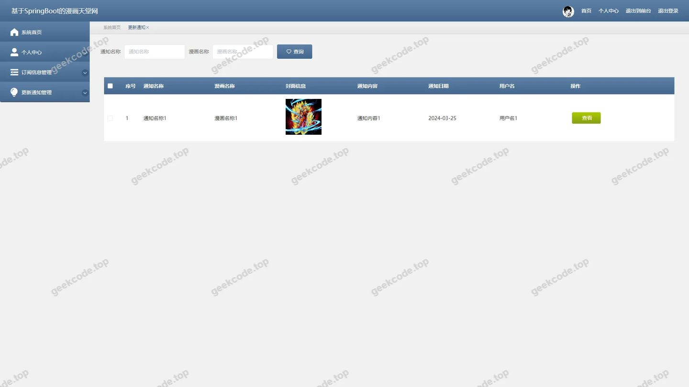
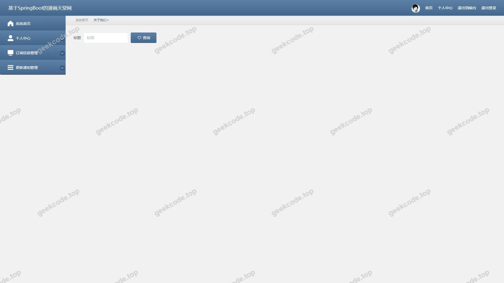
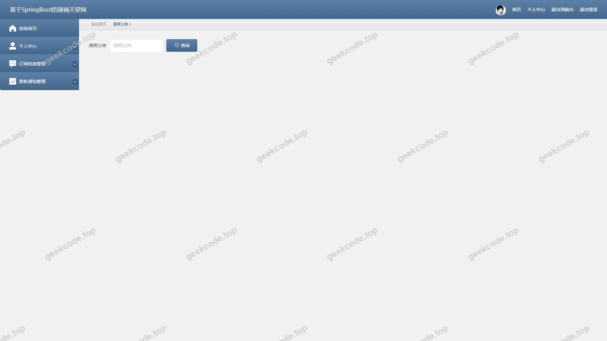
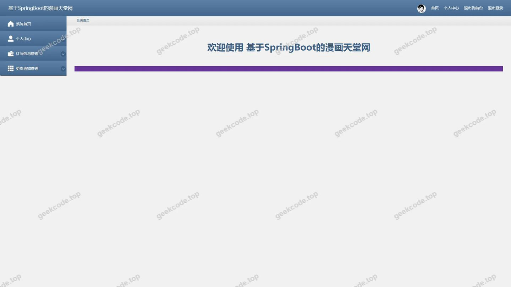

# 基于SpringBoot的漫画天堂网

> 🎓 **计算机毕业设计 · 基于SpringBoot的漫画天堂网**
>
> 本仓库只放**项目介绍 + 运行截图**（截图是站点带水印的原图，存在仓库 `images/` 里）。
>
> 👉 **完整可运行源码 / 数据库脚本 / 部署文档：[点我获取](https://geekcode.top/archives/%E5%9F%BA%E4%BA%8ESpringBoot%E7%9A%84%E6%BC%AB%E7%94%BB%E5%A4%A9%E5%A0%82%E7%BD%91?utm_source=github)**
>
> 💬 咨询微信：**ir9372**　|　🌐 更多项目：[极客代码 geekcode.top](https://geekcode.top/?utm_source=github)
>
> 📌 项目详情页：<https://geekcode.top/archives/%E5%9F%BA%E4%BA%8ESpringBoot%E7%9A%84%E6%BC%AB%E7%94%BB%E5%A4%A9%E5%A0%82%E7%BD%91?utm_source=github>

<table><td width="230" align="center"> <b>扫码加微信 ir9372</b></td><td valign="middle">📦 源码 = 项目介绍 + 全部运行截图 + 数据库 + 部署文档 👉 点上方任意截图，直接跳到 <b>极客代码 geekcode.top</b> 详情页</td></table>

---

<h1>基于SpringBoot的漫画天堂网</h1>
<h2>项目概述</h2>

本项目“基于SpringBoot的漫画天堂网”旨在构建一个集漫画资源展示、社区互动与信息管理于一体的综合性Web平台。系统采用前后端分离架构，核心功能涵盖漫画分类浏览、详细信息展示、用户留言反馈及公告通知发布。前台面向广大漫画爱好者，提供便捷的资讯获取与交流空间；后台面向管理员，实现对内容数据的高效维护与管理。技术栈选用 Spring Boot 作为后端框架，结合 MyBatis-Plus 进行持久层操作，并引入 Shiro 保障系统安全。该项目适用于中小型在线内容分发场景，具有开发效率高、扩展性强、安全性好的特点，能够有效解决传统静态页面更新滞后、交互性差的问题。

<h2>技术架构</h2>
<h3>整体架构</h3>

系统采用经典的前后端分离模式（vue-integrated），前端负责视图渲染与用户交互，后端提供 RESTful API 接口服务。

<h3>核心技术选型</h3>
<ol>
<li><strong>后端框架</strong>：使用 <code>spring-boot-starter-web</code> 构建高性能 Web 服务，利用其自动配置特性简化开发流程。</li>
<li><strong>持久层框架</strong>：集成 <code>mybatis-spring-boot-starter</code> 与 <code>mybatis-plus</code>，通过增强型 SQL 映射机制提升数据库操作效率，减少样板代码。</li>
<li><strong>安全框架</strong>：引入 <code>shiro-spring</code> 实现身份验证、授权管理及会话控制，确保系统访问的安全性。</li>
<li><strong>数据库驱动</strong>：使用 <code>mysql-connector-java</code> 连接 MySQL 数据库，配合 <code>spring-boot-starter-jdbc</code> 进行事务管理。</li>
<li><strong>辅助组件</strong>：包含 <code>commons-lang3</code> 工具类库处理通用逻辑，<code>validation-api</code> 用于参数校验，<code>protobuf-java</code> 支持高效的数据序列化需求。</li>
</ol>
<h2>功能模块</h2>

根据源码中的 Controller 列表及路由配置，系统主要划分为以下功能模块：

<h3>前台用户端</h3>

前台导航菜单包括：漫画信息、社区互动、公告信息、在线留言。

<ol>
<li><strong>漫画信息模块</strong></li>
</ol>
<ul>
<li><strong>漫画浏览</strong>：展示漫画封面、标题及简介，支持按分类筛选。</li>
<li><strong>详情查看</strong>：显示单部漫画的详细元数据及更新状态。</li>
<li><strong>评论互动</strong>：用户对特定漫画发表讨论或评价（对应 <code>DiscussdongmanxinxiController</code>）。</li>
</ul>
<ol start="2">
<li><strong>社区互动模块</strong></li>
</ol>
<ul>
<li><strong>论坛交流</strong>：提供用户发帖、回帖功能，形成活跃的粉丝社区（对应 <code>ForumController</code>）。</li>
<li><strong>在线留言</strong>：用户可向网站提交建议或反馈信息（对应 <code>MessagesController</code>）。</li>
</ul>
<ol start="3">
<li><strong>公告信息模块</strong></li>
</ol>
<ul>
<li><strong>新闻阅读</strong>：查看网站发布的最新资讯或行业动态（对应 <code>NewsController</code>）。</li>
<li><strong>更新通知</strong>：接收漫画连载更新提醒或系统重要通告（对应 <code>GengxintongzhiController</code>）。</li>
</ul>
<ol start="4">
<li><strong>基础信息模块</strong></li>
</ol>
<ul>
<li><strong>关于我们</strong>：展示网站介绍及联系方式（对应 <code>AboutusController</code>）。</li>
<li><strong>系统简介</strong>：呈现平台功能概要说明（对应 <code>Systemintro</code> 相关逻辑）。</li>
</ul>
<h3>后台管理端</h3>

后台路由覆盖所有业务实体的 CRUD 操作及系统配置。

<ol>
<li><strong>内容管理中心</strong></li>
</ol>
<ul>
<li><strong>漫画管理</strong>：录入、编辑、删除漫画基本信息及关联图片（<code>DongmanxinxiController</code>）。</li>
<li><strong>分类管理</strong>：维护漫画类型标签体系（<code>DongmanfenleiController</code>）。</li>
<li><strong>订阅管理</strong>：审核或管理用户的订阅申请记录（<code>DingyuexinxiController</code>）。</li>
</ul>
<ol start="2">
<li><strong>互动内容管理</strong></li>
</ol>
<ul>
<li><strong>评论管理</strong>：审查并处理用户对漫画的评论内容，支持删除违规言论（<code>DiscussdongmanxinxiController</code>）。</li>
<li><strong>留言管理</strong>：查看并回复用户提交的在线留言（<code>MessagesController</code>）。</li>
<li><strong>论坛管理</strong>：监控社区帖子状态，维护讨论区秩序（<code>ForumController</code>）。</li>
</ul>
<ol start="3">
<li><strong>信息发布中心</strong></li>
</ol>
<ul>
<li><strong>新闻管理</strong>：发布、修改或删除前台展示的新闻文章（<code>NewsController</code>）。</li>
<li><strong>通知管理</strong>：编辑和推送系统更新通知（<code>GengxintongzhiController</code>）。</li>
<li><strong>页面配置</strong>：更新“关于我们”、“系统简介”等静态页面内容（<code>AboutusController</code>, <code>ConfigController</code>）。</li>
</ul>
<ol start="4">
<li><strong>系统设置</strong></li>
</ol>
<ul>
<li><strong>用户管理</strong>：管理系统注册用户账号信息（<code>Yonghu</code> 相关路由）。</li>
<li><strong>文件上传</strong>：处理图片、附件等文件的上传与存储（<code>FileController</code>）。</li>
<li><strong>通用接口</strong>：提供字典数据查询、权限验证等公共服务（<code>CommonController</code>）。</li>
</ul>
<h2>用户角色与权限</h2>

基于 Shiro 安全框架及后台路由结构，系统主要涉及两类角色：

<h3>1. 普通用户（游客/注册读者）</h3>
<ul>
<li><strong>访问权限</strong>：仅可访问前台公开页面。</li>
<li><strong>具体功能</strong>：</li>
<li>浏览首页、漫画列表、漫画详情页。</li>
<li>查看公告、新闻、更新通知。</li>
<li>参与社区互动：在论坛发帖、对漫画发表评论。</li>
<li>提交在线留言。</li>
<li>查看“关于我们”和“系统简介”。</li>
<li><strong>限制</strong>：无法进入后台管理界面，无数据修改权限。</li>
</ul>
<h3>2. 系统管理员</h3>
<ul>
<li><strong>访问权限</strong>：拥有后台全部功能的管理权限。</li>
<li><strong>具体功能</strong>：</li>
<li><strong>登录后台</strong>：通过 <code>/admin/login</code> 或类似入口进行身份验证。</li>
<li><strong>数据全生命周期管理</strong>：对漫画信息、分类、新闻、通知、留言、评论、订阅信息进行增删改查。</li>
<li><strong>用户管理</strong>：查看和管理注册用户资料。</li>
<li><strong>系统配置</strong>：修改网站基本参数、文件上传配置等。</li>
<li><strong>内容审核</strong>：清理不良评论和留言，维护社区环境。</li>
</ul>
<h2>项目特色与创新点</h2>
<ol>
<li><strong>一体化内容生态</strong>：将传统的单向漫画展示升级为双向互动的社区平台，通过“社区互动”和“在线留言”模块增强了用户粘性，实现了从“看漫画”到“聊漫画”的场景延伸。</li>
<li><strong>高效的数据持久化方案</strong>：采用 MyBatis-Plus 替代传统 MyBatis，利用其内置的分页插件、条件构造器及代码生成器特性，大幅降低了后台复杂查询的开发成本，提升了系统响应速度。</li>
<li><strong>细粒度的权限与安全控制</strong>：集成 Apache Shiro 框架，实现了基于注解的方法级权限控制和会话管理，有效防止未授权访问和数据篡改，保障了用户隐私与系统稳定性。</li>
<li><strong>模块化设计</strong>：后端 Controller 按照业务领域清晰划分（如 News, Forum, Dongman 等），前端路由与后台功能严格对应，便于后续功能的独立迭代与维护。</li>
</ol>
<h2>部署环境</h2>

为确保系统正常运行，需准备以下软硬件环境：

<h3>软件环境</h3>
<ul>
<li><strong>操作系统</strong>：Windows 10/11, Linux (CentOS/Ubuntu) 或 macOS。</li>
<li><strong>Java 运行环境</strong>：JDK 1.8 或更高版本（推荐 JDK 8 LTS）。</li>
<li><strong>数据库</strong>：MySQL 5.7 或 MySQL 8.0。</li>
<li><strong>构建工具</strong>：Maven 3.6+。</li>
<li><strong>Node.js</strong>：若前端工程需要编译打包，需安装 Node.js (建议 v14+) 及 npm/yarn。</li>
<li><strong>Web 服务器</strong>：内置 Tomcat (Spring Boot 自带)，生产环境建议搭配 Nginx 进行反向代理。</li>
</ul>
<h3>硬件要求</h3>
<ul>
<li><strong>CPU</strong>：双核及以上处理器。</li>
<li><strong>内存</strong>：至少 4GB RAM（建议 8GB 以流畅运行 IDE 及调试过程）。</li>
<li><strong>磁盘空间</strong>：预留至少 2GB 可用空间用于存放数据库文件、日志及上传的图片资源。</li>
</ul>
<h3>启动步骤简述</h3>
<ol>
<li>导入 SQL 脚本至 MySQL 数据库，创建对应的 schema。</li>
<li>修改 <code>application.yml</code> 或 <code>application.properties</code> 中的数据库连接 URL、用户名和密码。</li>
<li>使用 Maven 命令 <code>mvn clean package</code> 打包项目。</li>
<li>执行 <code>java -jar target/project-name.jar</code> 启动后端服务。</li>
<li>配置前端 API 地址指向后端服务端口，启动前端开发服务器或部署静态资源。</li>
</ol>
<h2>五、技术特性</h2>
<ul>
<li>前后端集成部署，前端资源打包至后端 static 目录</li>
<li>使用 MyBatis-Plus 简化数据访问层开发</li>
<li>集成 Shiro 权限框架实现角色权限控制</li>
</ul>
<h2>六、功能模块截图</h2>
<h3>前台用户端</h3>
<h4>前台首页框架</h4>

<h3>后台管理端</h3>
<h4>后台-登录页</h4>

<h4>后台-订阅信息</h4>

<h4>后台-更新通知</h4>

<h4>后台-公告信息</h4>

<h4>后台-系统简介</h4>

<h4>后台-关于我们</h4>

<h4>后台-漫画分类</h4>

<h4>后台首页</h4>

---

## 获取完整源码

| 项目 | 说明 |
| --- | --- |
| 项目名 | 基于SpringBoot的漫画天堂网 |
| 运行截图 | 本文 10 张（站点带水印原图，仓库 `images/` 目录） |
| 完整源码 | [https://geekcode.top/archives/%E5%9F%BA%E4%BA%8ESpringBoot%E7%9A%84%E6%BC%AB%E7%94%BB%E5%A4%A9%E5%A0%82%E7%BD%91?utm_source=github](https://geekcode.top/archives/%E5%9F%BA%E4%BA%8ESpringBoot%E7%9A%84%E6%BC%AB%E7%94%BB%E5%A4%A9%E5%A0%82%E7%BD%91?utm_source=github) |
| 咨询微信 | **ir9372**（备注：jingpin-yuanma） |
| 更多项目 | [极客代码 geekcode.top](https://geekcode.top/?utm_source=github) |

> 需要源码、部署、改配置、跑不起来等问题，加微信 ir9372 沟通，说明项目名即可。
